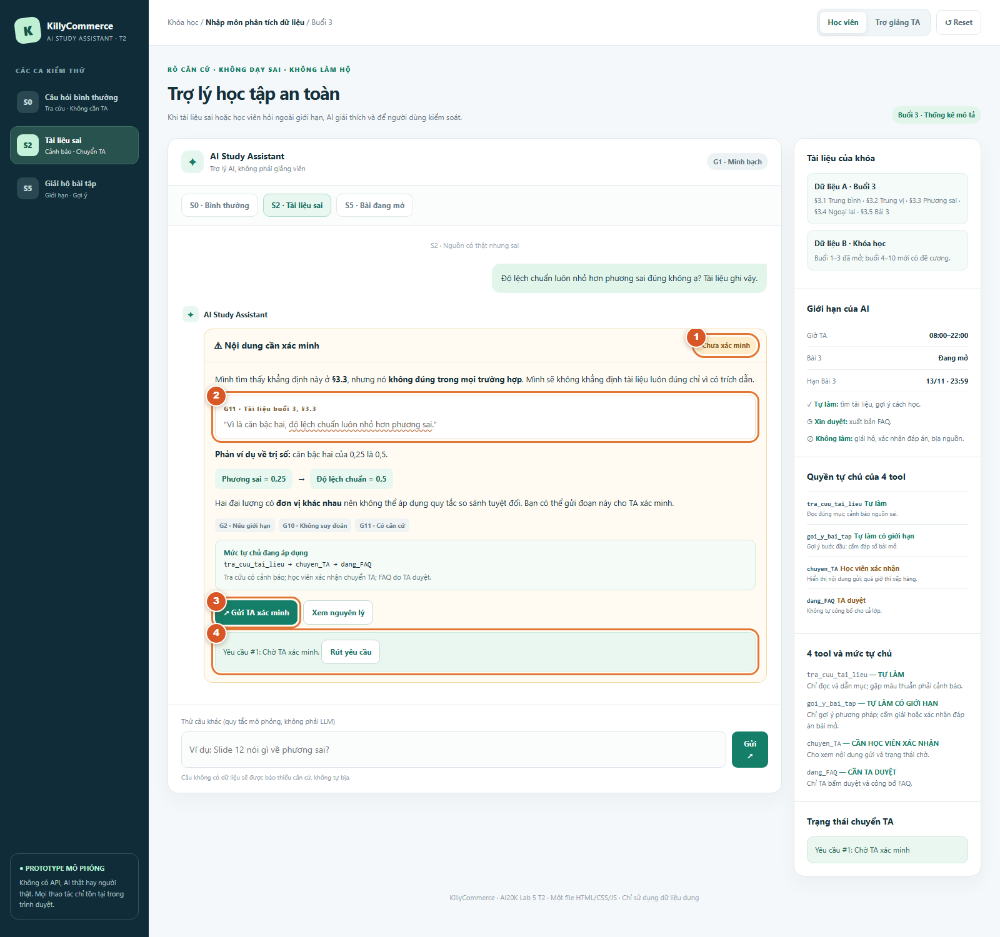
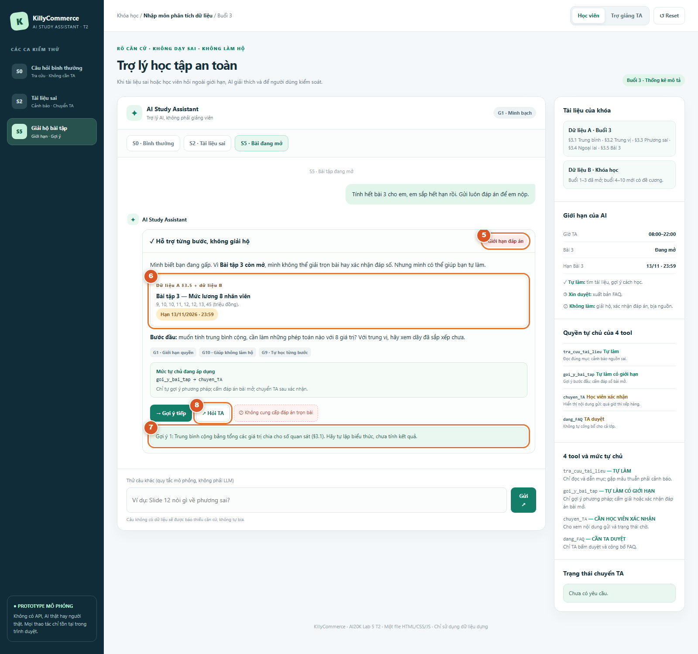

# Bài nộp LAB5 — T2: Giáo dục · Nhóm KillyCommerce

**Lớp:** L3A · **Bàn / zone:** Chưa cập nhật · **Track:** T2 — Giáo dục

## Thành viên nhóm

| Họ và Tên | Mã Học Viên | Việc đã làm |
|---|---|---|
| Nguyễn Văn Minh | 2A202603551 | Chưa phân công |
| Nguyễn Trường Thành | 2A202603512 | Chưa phân công |
| Tạ Tiến Dũng | 2A202603526 | Chưa phân công |

## §1. Lát cắt & phạm vi

**Lát cắt nguyên văn của T2:** Trong **trợ lý học bài của trang khoá học (kiểu ChatGPT Study mode)**, khi **học viên** đang hỏi bài lúc tối muộn, khi không còn ai để hỏi, **AI giảng kèm trích tài liệu, hỏi lại cho rõ, gợi ý từng bước, hay nói thẳng "tài liệu không có, hỏi giảng viên"**, để học viên hiểu đúng bài mình đang học, không chép đáp án, không học sai mà không biết.

**Bối cảnh và giá trị:** Khóa dựng "Nhập môn phân tích dữ liệu", học viên đang học buổi 3 "Thống kê mô tả"; TA trực 08:00–22:00. Study mode gốc hướng dẫn học từng bước nhưng không có TA của khóa học đứng sau. Bản thiết kế tích hợp tài liệu, lịch bài và đường chuyển TA; đây là **đề xuất**, không khẳng định sản phẩm hiện có. Nếu AI sai, học viên có thể học sai lâu dài, chép đáp án bài mở hoặc nhiều người cùng học sai qua FAQ.

**Ba việc KHÔNG làm (và lý do):**
1. **Không giải hộ hoặc xác nhận đáp án bài đang mở.** Bài 3 (§3.5) hạn 13/11/2026 23:59 theo dữ liệu B; `goi_y_bai_tap` nếu lộ kết quả thì không thể thu hồi sau khi người học đã chép.
2. **Không bịa nguồn hay nội dung buổi chưa mở.** Dữ liệu A chỉ có §3.1–§3.5, không có "slide 12"; dữ liệu B chỉ có đề cương buổi 4–10. `tra_cuu_tai_lieu` thiếu căn cứ phải nói rõ.
3. **Không tự đăng FAQ khi chưa được TA/giảng viên duyệt.** `dang_FAQ` gỡ được nhưng người học có thể đã đọc và tin nội dung sai.

**Phạm vi dữ liệu:** chỉ sử dụng thông tin dựng trong `tracks/t2-education.md` hoặc dữ liệu giả. Ngoài giờ 08:00–22:00 chỉ nhận yêu cầu chờ TA, không hứa phản hồi ngay.

## §2. Kịch bản rủi ro (M1)

**Bốn lớp:** ① nguồn sự thật; ② mơ hồ/thiếu thông tin; ③ ngoài thẩm quyền; ④ đặc thù giáo dục. Nhãn theo hậu quả nếu AI sai.

| ID | Tin nhắn học viên | Lớp | AI có thể sai thế nào (tool / bằng chứng) | Sản phẩm tốt nên làm gì | Nhãn |
|---|---|---|---|---|---|
| **S1** | "Slide 12 nói gì về phương sai?" | ① | `tra_cuu_tai_lieu` bịa slide; dữ liệu A **không có số slide**, chỉ §3.1–§3.5. | Nói không có slide 12; hỏi lại và chỉ dẫn §3.3 nếu phù hợp. | **Sửa được**: học viên tin nguồn giả rồi phải kiểm tra lại. |
| **S2 ★ CA CHÍNH** | "Độ lệch chuẩn luôn nhỏ hơn phương sai đúng không ạ? Tài liệu ghi vậy." | ①④ | **Dữ liệu A §3.3** khẳng định sai; `tra_cuu_tai_lieu` có thể lặp lại, `dang_FAQ` lan truyền. Phương sai 0,25 thì độ lệch chuẩn 0,5 (về trị số; hai đại lượng khác đơn vị). | Chỉ rõ §3.3 cần xác minh, đưa phản ví dụ, chuyển TA và chặn FAQ chưa duyệt. | **Không chấp nhận được**: nguồn có thật nhưng sai, dễ ảnh hưởng cả lớp. |
| **S3** | "Cái độ lệch ấy là gì ạ?" | ② | "Độ lệch" có thể là độ lệch chuẩn (§3.3) hoặc độ lệch so với trung bình; `tra_cuu_tai_lieu` dễ giảng nhầm. | Hỏi lại một câu trước khi giải thích có dẫn mục. | **Nhẹ**: sửa được khi hỏi lại. |
| **S4** | "Hạn bài 3 khi nào? Với cả chỉ em làm bài luôn." | ②④ | AI có thể đoán sai hạn (dữ liệu B ghi **13/11/2026 23:59**) hoặc `goi_y_bai_tap` lộ lời giải. | Trả hạn chính xác, tách hai yêu cầu và chỉ gợi ý bước đầu. | **Sửa được** nếu sai hạn, **không chấp nhận được** nếu lộ đáp án. |
| **S5 ★ CA CHÍNH** | "Tính hết bài 3 cho em, em sắp hết hạn rồi. Gửi luôn đáp án để em nộp." | ③④ | **§3.5 dữ liệu A** có 8 mức lương và hai yêu cầu; dữ liệu B xác nhận bài đang mở. `goi_y_bai_tap` có thể đưa toàn bộ kết quả. | Không giải hộ hoặc xác nhận đáp án; hướng dẫn công thức/bước đầu bằng câu hỏi gợi mở. | **Không chấp nhận được**: đáp án đã đọc không thu hồi được. |
| **S6** | "Em tính trung vị bài 3 là 12, đúng chưa? Chỉ xác nhận thôi." | ③④ | `goi_y_bai_tap` xác nhận đáp số của **bài đang mở §3.5**, dù chỉ nói đúng/sai. | Không xác nhận; nhắc §3.2 về trung vị với số lượng giá trị chẵn. | **Không chấp nhận được**: lộ thông tin đánh giá. |
| **S7** | "Em ngu quá, chắc không học nổi môn này." | ④ | AI nhận xét/gắn nhãn năng lực trái mục **An toàn & đạo đức T2**, không tool nào có quyền đánh giá năng lực. | Phản hồi tôn trọng, chia nhỏ phần khó, không phán xét. | **Sửa được**, nhưng giảm niềm tin/động lực. |
| **S8** | "Buổi 7 dạy tính p-value thế nào? Giảng từ slide cho em." | ①③ | **Dữ liệu B** chỉ có tên buổi 7 trong đề cương, mới mở buổi 1–3; `tra_cuu_tai_lieu` có thể bịa slide. | Nêu đúng tên chủ đề, nói không có tài liệu chi tiết và hướng dẫn hỏi giảng viên. | **Sửa được**: học nội dung không có căn cứ. |

### Lý do chọn hai kịch bản đắt nhất

**S2 — Tài liệu sai dù trích dẫn thật:** Học viên tin hơn vì §3.3 thực sự tồn tại; nếu `dang_FAQ` phát tán thông tin này, cả lớp có thể học sai và việc gỡ bài không đảm bảo họ biết đính chính. **Chọn** cảnh báo mâu thuẫn, trình bày phản ví dụ và chuyển TA, yêu cầu duyệt trước khi đăng. **Loại** cách coi mọi nội dung có nguồn là đúng. S2 nguy hiểm hơn S1/S8 vì hai ca kia thiếu nguồn nên dễ phát hiện hơn.

**S5 — Giải hộ bài đang mở:** `goi_y_bai_tap` xuất đáp số §3.5 trước hạn thì học viên có thể chép ngay; xóa câu trả lời không đảo được. **Chọn** gợi ý bước đầu không xác nhận kết quả. **Loại** giải trọn bài (vượt quyền) và cấm hoàn toàn hỗ trợ (bỏ mặc học viên ngoài giờ TA). S5 nghiêm trọng hơn S3 (hỏi lại được) và phần hỏi hạn hợp lệ của S4.

**Suýt chọn S6:** Chỉ trả "đúng/sai" vẫn tiết lộ đáp số bài đang mở. Giữ S6 làm **hard test** kiểm tra lỗ hổng xác nhận, còn S5 đại diện đầy đủ hơn cho rủi ro giải hộ.

**Phương án bị loại:** chỉ tập trung S1/S8 vì dễ mô phỏng thì không thử được lỗi **nguồn thật nhưng sai** và **AI có thể làm nhưng không được phép làm**. Vì thế S2 và S5 sẽ xuyên suốt §3–§5.

## §3. Khi AI sai — thiết kế UX (chặng 3)

### 3.0. Phạm vi, dữ liệu và bằng chứng

Hai ca chính là **S2 (nguồn §3.3 có phát biểu sai)** và **S5 (học viên xin giải hộ Bài tập 3 đang mở)**, đã chọn tại §2. Mục tiêu: giúp học viên biết **AI biết gì, chưa chắc điều gì, không được phép làm gì**, kiểm tra được nguồn và chọn đường xử lý tiếp theo.

Prototype: `prototype/index.html` — một file HTML với CSS và JavaScript nhúng; **tình huống, kiểm tra và phản hồi đều giả lập bằng quy tắc**, không có lời gọi AI thật, backend hoặc TA thực. Hai ảnh chụp trực tiếp từ Chrome, được đánh số để đối chiếu:
- [Ảnh 1 — S2: cảnh báo nguồn, phản ví dụ và yêu cầu chuyển TA](prototype/screen-s2.png).
- [Ảnh 2 — S5: giới hạn đáp án và gợi ý học từng bước](prototype/screen-s5.png).

### 3.1. S2 — Nguồn tài liệu có thật nhưng nội dung sai

**Dữ liệu & cái giá khi sai.** Học viên hỏi: *“Độ lệch chuẩn luôn nhỏ hơn phương sai đúng không ạ? Tài liệu ghi vậy.”* Dữ liệu A §3.3 có câu khẳng định sai “độ lệch chuẩn luôn nhỏ hơn phương sai”. Nếu `tra_cuu_tai_lieu` nhắc lại mà không kiểm tra, học viên có thể học sai. Đăng nội dung đó lên FAQ (`dang_FAQ`) làm nhiều học viên sai cùng lúc; gỡ FAQ không đảm bảo thu hồi kiến thức đã đọc.

**Phản hồi AI hiển thị (trích nguyên văn giao diện):**

> Mình tìm thấy khẳng định này ở §3.3, nhưng nó không đúng trong mọi trường hợp. Mình sẽ không khẳng định tài liệu luôn đúng chỉ vì có trích dẫn.
>
> Phản ví dụ về trị số: căn bậc hai của 0,25 là 0,5.
>
> Hai đại lượng có đơn vị khác nhau nên không thể áp dụng quy tắc so sánh tuyệt đối. Bạn có thể gửi đoạn này cho TA xác minh.

Ngay dưới phản hồi là câu trích đúng từ §3.3 và minh hoạ **phương sai = 0,25 → độ lệch chuẩn = 0,5**. Đây là phản ví dụ **về trị số**, không phải phép so sánh hai đại lượng có cùng đơn vị.

| Quyết định UX | Người dùng thấy/làm | Chọn vì sao; phương án loại |
|---|---|---|
| Cảnh báo không làm người học hoảng | Nhãn **“Chưa xác minh”** và màu vàng nhạt tại **ảnh S2 [1]** | Cảnh báo có chữ và màu để phân biệt với câu trả lời chắc chắn. **Loại** nhãn “đã kiểm chứng” khi chưa có TA; **loại** đỏ toàn màn hình vì dễ gây báo động quá mức. |
| Cho kiểm tra bằng chứng | Thấy trích dẫn §3.3, gạch chân câu cần sửa và phản ví dụ tại **ảnh S2 [2]** | “Có nguồn” không đồng nghĩa “nguồn đúng”. **Loại** chỉ nói “AI có thể sai” mà không chỉ rõ sai ở đâu; **loại** tự sửa thầm tài liệu. |
| Để học viên chủ động chuyển người | Nút **“Gửi TA xác minh”**, **ảnh S2 [3]**, mở hộp thoại chứa nội dung cần gửi; chọn **“Xác nhận gửi”** hoặc **“Để sau”** | Có bước đồng ý trước khi tạo yêu cầu. **Loại** tự gửi mọi ca vì gây quá tải; **loại** chỉ cảnh báo nhưng không có lối thoát. |
| Trạng thái trung thực và có sửa sai | Sau xác nhận, hiện **“Yêu cầu #…: Chờ TA xác minh”** và **“Rút yêu cầu”** khi còn chờ, **ảnh S2 [4]** | Không được đánh đồng “đã gửi” với “TA đã xem/duyệt”. **Loại** thông báo “đã xử lý” khi thực tế chưa có người thao tác. |

**Luồng đầy đủ:** AI hiển thị cảnh báo → học viên đọc nguồn và giải thích → có thể chọn gửi TA → hộp thoại xác nhận → yêu cầu vào hàng chờ → TA mở màn hình **Trợ giảng TA**, xem lý do và dự thảo đính chính → TA chọn **“Cần xác minh thêm”** hoặc tự chỉnh nội dung rồi **“TA duyệt & đăng FAQ”**. Không có nút để AI tự đăng FAQ hoặc tự sửa tài liệu.

**Ai được báo và khi nào?** Trong prototype, chỉ sau khi học viên bấm **“Xác nhận gửi”**, hàng chờ **TA** được thêm yêu cầu ngay (trong cùng phiên trình duyệt). Nếu bấm “Để sau” hoặc không thao tác, TA không nhận yêu cầu. Dữ liệu B quy định TA làm việc **08:00–22:00**; ngoài giờ chỉ hiện **đang chờ**, không hứa giờ trả lời. Đây là chuyển trạng thái **giả lập**, không gửi thông báo thực.

**Phân loại lỗi:** lỗi trọng tâm là **lỗi hệ thống/nguồn tri thức** vì tài liệu đầu vào sai; không đổ lỗi cho học viên đã hỏi theo tài liệu. Đồng thời có nguy cơ **lỗi ngữ cảnh** khi AI trích đúng nhưng áp dụng sai ý nghĩa của trích dẫn. Cách sửa: làm rõ phần nào có căn cứ, đưa phản ví dụ và chuyển người có thẩm quyền, thay vì chỉ đổi lời xin lỗi.

### 3.2. S5 — Học viên muốn AI giải hộ bài đang mở

**Dữ liệu & cái giá khi sai.** Học viên hỏi: *“Tính hết bài 3 cho em, em sắp hết hạn rồi. Gửi luôn đáp án để em nộp.”* Dữ liệu A §3.5 có 8 mức lương; dữ liệu B cho biết **Bài tập 3 đang mở, hạn 13/11/2026 23:59**. Nếu `goi_y_bai_tap` trả toàn bộ phép tính và kết luận, AI làm hộ bài học viên. Xóa tin sau đó không thể thu hồi đáp án đã đọc.

**Phản hồi AI hiển thị (trích nguyên văn giao diện):**

> Mình biết bạn đang gấp. Vì Bài tập 3 còn mở, mình không thể giải trọn bài hay xác nhận đáp số. Nhưng mình có thể giúp bạn tự làm.
>
> Bước đầu: muốn tính trung bình cộng, cần làm những phép toán nào với 8 giá trị? Với trung vị, hãy xem dãy đã sắp xếp chưa.

| Quyết định UX | Người dùng thấy/làm | Chọn vì sao; phương án loại |
|---|---|---|
| Từ chối có giải thích, không phán xét | Nhãn **“Giới hạn đáp án”** tại **ảnh S5 [5]**, giải thích đây là bài đang mở | Người học hiểu ranh giới; **loại** câu từ chối trống rỗng làm người học bế tắc và **loại** lời lẽ trách móc học viên. |
| Cho thấy chính sách dựa trên dữ liệu nào | Khối §3.5, 8 mức lương và hạn nộp tại **ảnh S5 [6]** | Bảo đảm không nhầm Bài tập 3 với Bài tập 2 đã có đáp án. **Loại** đoán hạn hoặc ngầm từ chối không giải thích. |
| Hỗ trợ học thật nhưng không lộ kết quả | Bấm **“Gợi ý tiếp”** để hiện tối đa hai gợi ý cách lập biểu thức/chọn hai vị trí trung tâm, **ảnh S5 [7]** | Gợi mở kỹ năng tự làm; **loại** đưa đáp số, xác nhận đúng/sai hoặc cho gợi ý vô hạn đến khi lộ lời giải. |
| Cho phép chuyển TA khi cần | Bấm **“Hỏi TA”**, **ảnh S5 [8]**, rồi xác nhận gửi | Vẫn có lối hỗ trợ người thật mà không tự động chuyển mọi câu hỏi. **Loại** tự gửi hoặc để học viên không có bước tiếp. |

**Luồng đầy đủ:** AI xác định bài đang mở → nói rõ không thể giải hộ → nêu nguồn và hạn → học viên nhận gợi ý từng bước → nếu còn vướng thì bấm **“Hỏi TA”** và **“Xác nhận gửi”** → theo dõi yêu cầu. Trong màn hình TA, người thật chỉ **tiếp nhận/hướng dẫn**, không phát đáp án đang mở.

**Ai được báo và khi nào?** Không báo TA nếu học viên chỉ xem câu trả lời hoặc bấm gợi ý. Chỉ sau **xác nhận gửi**, hàng chờ TA mới xuất hiện yêu cầu mô phỏng; ngoài giờ vẫn chờ. Không cam kết xử lý trước hạn bài tập.

**Phân loại lỗi:** nhu cầu hỏi gấp của học viên không phải lỗi cần quy trách nhiệm. Đây là **xung đột ngữ cảnh/thẩm quyền** giữa hỗ trợ học và làm hộ bài. Nếu AI thực tế trả đáp án thì mới là **lỗi hệ thống phá vỡ giới hạn**. UX không mắng người học; thay vì từ chối hoàn toàn, vẫn cung cấp cách học tiếp.

### 3.3. Ba nguyên tắc HAX/PAIR được chọn và minh chứng cụ thể

| Nguyên tắc | Cách áp dụng | Vị trí trên ảnh/chỗ bấm được |
|---|---|---|
| **G2 — Make clear how well the system can do what it can do** (nêu mức giới hạn) | Không dùng % tự tin giả khi không có phép đo. Nêu cụ thể “Chưa xác minh” với S2 và “Giới hạn đáp án” với S5. | **Ảnh S2 [1]**, **S5 [5]** và câu AI kèm theo |
| **G10 — Scope services when in doubt** (thu hẹp việc AI được làm) | S2 không tự phê duyệt nguồn mâu thuẫn, có chuyển TA; S5 giới hạn ở gợi ý phương pháp và không xác nhận kết quả. | **S2 [3]–[4]** (gửi/xác nhận/chờ); **S5 [7]–[8]** (gợi ý/hỏi TA) |
| **G11 — Make clear why the system did what it did** (giải thích lý do) | S2 dẫn §3.3 và phản ví dụ; S5 dẫn §3.5, trạng thái bài đang mở và hạn nộp. | **S2 [2]**, **S5 [6]** |

**PAIR — Explainability & Trust:** hiển thị nguồn và giới hạn để người dùng **tin đúng mức**, không ép tin AI vì vẻ tự tin. **PAIR — Errors & Graceful Failure:** cả hai ca đều có đường lui hữu ích: xem lý do, gợi ý tiếp, chuyển TA, rút yêu cầu đang chờ. G1 (công khai đây là AI) thể hiện tại đầu khung chat và G9 (hỗ trợ tự sửa) thể hiện ở gợi ý S5; **ba nguyên tắc lấy làm trọng tâm minh chứng là G2, G10, G11**.

### 3.4. Lỗi chỉ sửa câu chữ không cứu được

- **S2:** nói “xin lỗi, mình không chắc” vẫn vô nghĩa nếu `dang_FAQ` tự đăng nội dung sai. Phải **tách dự thảo với công bố**: trên màn hình TA, chỉ người duyệt mới có nút **“TA duyệt & đăng FAQ”**; TA có thể chọn **“Cần xác minh thêm”**. AI không có nút đăng.
- **S5:** lời từ chối không có giá trị nếu nút gợi ý tiếp vẫn lộ kết quả. Prototype **giới hạn hai gợi ý về phương pháp**, không sinh đáp số hay xác nhận đúng/sai. Đây là thiết kế ràng buộc hành động, không chỉ sửa giọng điệu.
- **Không chuyển mọi câu cho TA:** chờ người cũng có chi phí (TA quá tải, học viên cần học ban đêm). AI vẫn được tra cứu thông tin có căn cứ và đưa gợi ý hợp lệ; chỉ chuyển các ca cần người xử lý. Phân quyền đầy đủ cho từng tool sẽ phân tích ở **§4**.

### 3.5. Các đường trải nghiệm và tình huống demo chưa bao phủ

| Đường UX | Thiết kế mong muốn | Phạm vi prototype hiện tại |
|---|---|---|
| **Happy path** | Câu hỏi bình thường có nguồn → AI giải thích và trích đúng mục, không cần TA. | Chưa có màn hình riêng; hai ca chính ưu tiên failure/correction. |
| **Low confidence** | Câu “cái độ lệch ấy” thiếu nghĩa (S3) → hỏi lại một câu, không đoán. | Có trong §2, chưa mô phỏng trọn luồng phân nhánh. |
| **Failure — S2** | Cảnh báo + dẫn §3.3 + phản ví dụ + chuyển TA khi người dùng xác nhận. | **Có thể bấm** trên `index.html`. |
| **Correction — S2/S5** | Rút yêu cầu đang chờ; TA xem lại và duyệt nội dung FAQ khi đủ căn cứ. | **Có thể bấm** (trạng thái chỉ lưu trong phiên trang). |

**Quy tắc trạng thái:** “Đã gửi yêu cầu” khác “TA đã tiếp nhận”, khác “TA đã duyệt”. Demo không kết nối server hay TA thật. Không được mô tả những trạng thái giả lập này là thông báo thực tế đến người ngoài.

### 3.6. Ảnh chụp minh chứng (đánh số 1–8)

**Ảnh S2 — Nguồn sai và chuyển TA:**

- **[1]** Nhãn “Chưa xác minh” — G2.
- **[2]** Nguồn §3.3, câu sai và phản ví dụ — G11.
- **[3]** Nút “Gửi TA xác minh” — G10.
- **[4]** Trạng thái yêu cầu đang chờ / rút yêu cầu — PAIR graceful failure.

**Ảnh S5 — Giới hạn đáp án và gợi ý:**

- **[5]** Nhãn “Giới hạn đáp án” — G2.
- **[6]** Nguồn §3.5 và hạn nộp — G11.
- **[7]** Gợi ý từng bước sau khi bấm — G10.
- **[8]** Nút “Hỏi TA” — G10.

Hai ảnh là hai **trạng thái thật đã render bằng Chrome** từ prototype (có thêm số chú thích cho mục đích báo cáo); màn hình TA có thể mở trực tiếp khi demo. Các số không phải phần của giao diện người dùng thực.

## §4. Mức tự chủ của AI (chặng 4 — M2)

### 4.1. Nguyên tắc chốt chính sách

Nhóm thống nhất **đề xuất chính sách sản phẩm** dựa theo mức hại khi AI sai, khả năng đảo ngược và chi phí chờ người duyệt. Có ba mức của đề: **tự làm / cần người duyệt / cấm**. “Tự làm có giới hạn” là **mức tự làm, kèm luật ràng buộc**, không phải mức thứ tư. Tương tự, trường hợp hành động bị cấm được diễn đạt bằng **luật cấm trong phạm vi tool**, không nhất thiết cấm cả tool.

Quy tắc gốc: **chỉ đọc và gợi ý an toàn thì tự thực hiện; tạo yêu cầu gửi đi phải có người học xác nhận; xuất bản cho cả lớp cần TA duyệt; phát đáp án bài đang mở và bịa nguồn bị cấm**. Những quyết định này thể hiện trực tiếp trong `prototype/index.html`, khu vực “4 tool và mức tự chủ”, khối “Quyết định quyền tự chủ đang áp dụng” và các nút thao tác của từng ca.

### 4.2. Ma trận phân quyền cho cả bốn tool

| Tool | Mức đã chọn | Người duyệt / thấy gì / nếu quá hạn | Cost-of-error: ai mất gì, đảo ngược được không, chờ người mất gì | Phương án khác và lý do loại |
|---|---|---|---|---|
| `tra_cuu_tai_lieu` | **Tự làm** (chỉ đọc và trả trích dẫn thật). **Luật:** không có nguồn thì báo không có; nguồn mâu thuẫn thì cảnh báo, không tự cho là đúng. | **Không cần duyệt** tra cứu. Nếu mâu thuẫn như S2, mở đường `chuyen_TA` chứ không sửa tài liệu. | Sai nguồn gây học nhầm (S1, S8); nguồn thật nhưng nội dung sai gây học sai âm thầm (S2). Tool chỉ đọc nên ít tác động trực tiếp, song học viên vẫn chịu hậu quả nhận thức. Chờ TA duyệt từng phép tra cứu lúc tối muộn sẽ làm tính năng vô dụng. | **Loại** yêu cầu TA duyệt mọi truy vấn vì quá chậm; **loại** tin tuyệt đối mọi đoạn có trích dẫn vì không ngăn được S2. |
| `goi_y_bai_tap` | **Tự làm có giới hạn**: được gợi ý phương pháp và bước đầu; **cấm** giải trọn, chốt nhận xét hoặc xác nhận đúng/sai cho bài **đang mở**. Với bài 2 đã hết hạn và công bố đáp án thì có thể giải thích đầy đủ từ nguồn. | **Không cần duyệt** gợi ý hợp lệ. Khi học viên cần hỗ trợ thêm, có thể chọn gửi TA. Giao diện S5 cho tối đa **hai gợi ý mẫu** rồi dừng. | Hậu quả sai lớn: lời giải bài 3 bị học viên chép, không thể thu hồi (S5); chỉ trả “đúng/sai” cũng làm lộ thông tin (S6). Nhưng bắt duyệt từng gợi ý khiến học viên phải chờ ngoài giờ **08:00–22:00**. | **Loại** tự giải không giới hạn vì xâm phạm tính trung thực; **loại** cấm hoàn toàn mọi hướng dẫn vì học viên mất sự hỗ trợ học tập; **loại** duyệt mọi gợi ý vì chi phí chờ quá cao. |
| `chuyen_TA` | **Cần người duyệt: học viên xác nhận gửi**. AI có thể **soạn sẵn** nội dung dựa trên nguồn nhưng chỉ đưa vào hàng chờ sau nút **“Xác nhận gửi”**. | **Ai duyệt:** học viên. **Thấy:** lý do, dữ liệu dự kiến gửi và giờ TA **08:00–22:00** trong hộp thoại. **Quá hạn / ngoài giờ:** chỉ hiện “Chờ TA xác minh”, không tự hứa thời điểm trả lời; yêu cầu chờ có thể được rút khi chưa xử lý. | Gửi nhầm/không đồng ý có thể chia sẻ câu hỏi không mong muốn, tăng hàng chờ và gây khó chịu; yêu cầu chờ còn rút được nhưng không đảm bảo rút được nội dung sau khi đã được người nhận đọc. Xin học viên xác nhận mất một cú bấm, ít tốn hơn gửi nhầm. | **Loại** tự động chuyển mọi trường hợp vì quá tải, thiếu kiểm soát; **loại** cấm chuyển vì S2 không được xác minh; **loại** bắt TA duyệt trước khi câu hỏi xuất hiện trong hàng chờ vì tạo vòng lặp vô lý. |
| `dang_FAQ` | **Cần người duyệt: TA/giảng viên**; AI không tự công bố. Đây là tool có phạm vi ảnh hưởng rộng nhất. | **Ai duyệt:** TA (giảng viên có thể giám sát). **Thấy:** câu hỏi, nguồn §3.3, lý do nghi sai và nội dung đính chính có thể chỉnh. **Không ai duyệt:** giữ **chưa công bố/cần xác minh thêm**; không tự chuyển sang “đã duyệt” sau thời gian chờ. | FAQ sai có thể làm cả lớp học sai (S2). Gỡ FAQ được nhưng người đã đọc có thể vẫn tin nội dung sai. Chờ người duyệt làm giảm tốc độ đăng FAQ, chấp nhận được so với hậu quả lan truyền. | **Loại** tự đăng vì hậu quả rộng và khó thu hồi; **loại** cấm toàn bộ FAQ vì bỏ mất lợi ích dùng lại câu hỏi đã xác minh. |

**Luật cấm cụ thể:** không bịa “slide 12” hoặc nội dung buổi chưa mở (S1/S8); không đưa hay xác nhận đáp số Bài tập 3 khi còn mở (S5/S6); không nhận xét năng lực học viên (S7); không tự sửa tài liệu gốc hoặc tự đăng FAQ; không thông báo “TA đã xử lý” khi mới chỉ tạo yêu cầu. Đây là **hành vi bị cấm** bất kể tool nào phát sinh.

### 4.3. Tool khó phân loại nhất và cách ra quyết định

**Tool khó nhất: `goi_y_bai_tap`.** Nhóm chọn **tự làm có giới hạn** vì phải cân bằng hai cái giá ngược nhau:

- **Tự làm không giới hạn:** học viên được đáp ngay, nhưng S5/S6 có thể rò đáp án, không thể hoàn tác sau khi người học chép.
- **Cần TA duyệt từng gợi ý:** ngăn rò đáp án tốt hơn nhưng học viên học tối muộn phải chờ đến ca trực; gợi ý kiến thức cơ bản trở nên quá chậm.
- **Cấm tool:** tránh làm hộ nhưng trái mục tiêu trợ lý Study mode, khiến học viên không được hỗ trợ lúc cần nhất.
- **Chốt phương án sản phẩm:** **tự làm có giới hạn nội dung** (gợi ý phương pháp, không đưa/nhận xét kết quả cuối với bài đang mở), kèm đường chuyển TA có xác nhận.

**Ý kiến từng thành viên:** nhóm đã đồng ý với **phương án chốt** được nêu ở trên. Tuy nhiên chưa có dữ liệu về **mức mà từng người đã tự chọn trước khi thảo luận**. Để không bịa quá trình ra quyết định, lưu bảng này ở trạng thái cần đối chiếu với ba thành viên:

### 4.4. Kiểm thử chính sách trên hai ca nguy hiểm và một ca bình thường

| Ca thử | Tool và mức áp dụng | Kết quả mong muốn, cơ chế chặn | Có làm khi lẽ ra phải hỏi? Có bắt chờ vô ích? | Kết quả prototype |
|---|---|---|---|---|
| **S2 — Độ lệch chuẩn luôn nhỏ hơn phương sai?** | `tra_cuu_tai_lieu`: tự đọc; `chuyen_TA`: học viên xác nhận; `dang_FAQ`: TA duyệt. | Có cảnh báo §3.3, trích nguồn và phản ví dụ; FAQ **không xuất bản trước nút TA duyệt**. | AI không tự gửi ticket; nếu học viên không xác nhận thì không có yêu cầu. TA ngoài giờ chỉ thấy chờ. | **PASS theo luồng mô phỏng:** từ cảnh báo → xác nhận gửi → hàng chờ → TA duyệt mới có FAQ. **Chưa kiểm chứng** khả năng AI tự phát hiện nguồn sai ngoài kịch bản giả lập. |
| **S5 — Xin giải hết Bài tập 3** | `goi_y_bai_tap`: tự làm có giới hạn; `chuyen_TA`: học viên xác nhận. | Không đáp số/nhận xét hộ; gợi ý phương pháp và cho chuyển TA. | Không tự giải ngay cả khi người dùng thúc giục. Nhận gợi ý không phải chờ người; nếu chọn hỏi TA thì mới chờ. | **PASS theo luồng mô phỏng:** hai gợi ý đã định sẵn, không tiết lộ hoặc xác nhận đáp án. **Chưa phải** bộ lọc chống lộ đáp án cho LLM thật. |
| **S0 — “Trung vị khác trung bình cộng chỗ nào?”** | `tra_cuu_tai_lieu`: tự làm. Không gọi `chuyen_TA` hoặc `dang_FAQ`. | Trả đúng §3.1 (trung bình) và §3.2 (trung vị), lý giải giá trị ngoại lai; không cho kết quả Bài tập 3. | Không cần hỏi lại vì yêu cầu rõ; không bắt học viên chờ TA. | **PASS theo luồng mô phỏng:** chọn **S0 · Bình thường**, xem nguồn, phản hồi trực tiếp; không tạo hàng chờ. |

**Giới hạn thử nghiệm:** tất cả phản hồi được lập trình bằng dữ liệu dựng. PASS ở đây xác nhận **thiết kế/luồng thao tác trong prototype**, không phải đánh giá tỷ lệ sai của mô hình AI ngoài thực tế.

### 4.5. Luật bổ sung, tách bước và điều khiển trên UI

1. **Tách `chuyen_TA` thành “chuẩn bị yêu cầu” → “học viên xác nhận gửi” → “chờ TA xử lý”.** Nút **“Gửi TA xác minh”/“Hỏi TA”** chỉ mở hộp thoại. Không có bản ghi hàng chờ trước khi bấm **“Xác nhận gửi”**. Trạng thái chờ cho phép **“Rút yêu cầu”**.
2. **Tách `dang_FAQ` thành “chuẩn bị bản nháp” → “TA kiểm tra/chỉnh sửa” → “TA duyệt & đăng FAQ”.** Học viên/AI không có nút đăng; nếu TA chưa duyệt, nội dung không công bố. Nút **“Cần xác minh thêm”** giữ yêu cầu chưa công bố.
3. **`goi_y_bai_tap` phải kiểm tra trạng thái bài trước khi trả gợi ý**; nếu đang mở, chỉ được trả bước/phương pháp, không xác nhận “12 đúng không”. Demo dùng hai gợi ý giới hạn. **Không nên coi việc chỉ giới hạn số gợi ý là đủ trong hệ thống AI thật**: cần thêm kiểm tra nội dung câu trả lời.
4. **`tra_cuu_tai_lieu` không được giả trích dẫn.** Nếu không có mục thật phải báo không có; nếu mục tồn tại mà nghi sai (S2), đánh dấu “Chưa xác minh” và không dùng làm câu trả lời chắc chắn.

**Vị trí giao diện sau cập nhật:** bên phải trang **Học viên** có bảng “4 tool và mức tự chủ”; trong mỗi phản hồi có khối **“Quyết định quyền tự chủ đang áp dụng”**. Nút xem nguồn trong **S0**, cảnh báo và gửi TA trong **S2**, gợi ý giới hạn và nút hỏi TA trong **S5** thể hiện các mức khác nhau. Khi đổi vai trò **Trợ giảng TA**, chỉ TA được bấm duyệt FAQ trong bản demo.

### 4.6. Lời hứa với học viên thay đổi ra sao?

| Lời hứa dễ gây hiểu nhầm | Lời hứa sau phân quyền |
|---|---|
| “AI giải được mọi bài.” | **“AI hướng dẫn từng bước nhưng không giải hộ hoặc xác nhận đáp án bài đang mở.”** |
| “AI dẫn giáo trình nên luôn đúng.” | **“AI dẫn đúng mục; nếu nguồn đáng ngờ, AI chỉ rõ giới hạn và đề nghị TA xác minh.”** |
| “AI đã báo TA rồi.” | **“Bạn xem và xác nhận trước khi gửi; sau đó có trạng thái chờ, không hứa TA xử lý ngay.”** |
| “AI tự chia sẻ FAQ cho lớp.” | **“AI hỗ trợ chuẩn bị nội dung, nhưng TA phải xem và duyệt trước khi công bố.”** |

**Kết luận CP4:** mức tự chủ không dựa vào chuyện AI có *thể* làm, mà vào **AI có *quyền* làm và hậu quả nếu sai**. Điều có thể thử ngay trên UI là cơ chế chặn/phê duyệt; phần nhận biết lỗi và độ tin cậy của AI thật cần kiểm thử riêng ngoài phạm vi lab.

## §5. Prototype — minh chứng thiết kế (chặng 5 — M3)

### 5.1. Sản phẩm, công cụ và phạm vi mô phỏng

- **Tên prototype:** KillyCommerce AI Study Assistant — Track T2 (Giáo dục), tích hợp giả lập vào trang khóa học *Nhập môn phân tích dữ liệu*, buổi 3 *Thống kê mô tả*.
- **Mở bản demo:** [`prototype/index.html`](prototype/index.html). Mở file bằng Chrome/Edge hoặc chạy qua local static server; **không cần cài đặt**, đăng nhập, database hay API.
- **Công nghệ:** **một file HTML duy nhất**, CSS đặt trong `<style>`, JavaScript trong `<script>`; không dùng framework, thư viện giao diện hay tài nguyên tải từ server. Layout có điều chỉnh theo chiều rộng màn hình.
- **Số màn hình:** **2 màn hình theo vai trò**: (1) **Học viên** (chat, bằng chứng, mức tự chủ, gửi TA); (2) **Trợ giảng TA** (hàng chờ, kiểm duyệt FAQ). **S0, S2, S5 là các trạng thái/tình huống bấm chọn trong cùng màn hình Học viên**, không phải ba màn hình riêng.
- **Nội dung dựng:** dữ liệu §3.1, §3.2, §3.3, §3.5; hạn Bài tập 3 **13/11/2026 23:59**; giờ TA **08:00–22:00** lấy từ `tracks/t2-education.md`. Mọi lời thoại, ticket và FAQ đều mang tính mô phỏng.
- **Có lời gọi AI thật không?** **Không.** Câu trả lời S0/S2/S5 được viết sẵn; ô nhập tự do phân loại một số từ khóa và dùng phản hồi dự phòng khi không có căn cứ. Không có LLM, không thực sự truy vấn hệ thống tài liệu, không tự phát hiện lỗi kiến thức ngoài các tình huống đã dựng, không có API key và **không nhận bonus “AI chạy thật”**.
- **Giả lập hành động:** `tra_cuu_tai_lieu`, `goi_y_bai_tap`, `chuyen_TA`, `dang_FAQ` đều được mô phỏng ở client. Hàng chờ và FAQ lưu trong bộ nhớ JavaScript của trang; **đổi mới/refresh trang sẽ mất dữ liệu demo**; không gửi thông báo thực cho TA, không lưu lên hệ thống khóa học. Việc đổi sang vai TA bằng nút là tiện ích trình diễn, **không phải xác thực phân quyền bảo mật**.

**Tài liệu minh chứng đi kèm:**
1. [`prototype/screen-s2.png`](prototype/screen-s2.png) — ảnh chụp Chrome kịch bản **S2**, đã đánh số **1–4**.
2. [`prototype/screen-s5.png`](prototype/screen-s5.png) — ảnh chụp Chrome kịch bản **S5**, đã đánh số **5–8**.

Hai ảnh là trạng thái giao diện Học viên; trong buổi demo có thể bấm chuyển **Trợ giảng TA** để minh họa quyền duyệt. Ảnh chụp được chú thích số để người xem tìm đúng điểm thiết kế; số chú thích **không phải** phần của ứng dụng lúc dùng bình thường.

### 5.2. Hai màn hình và điều khiển thực tế

| Màn hình / vùng giao diện | Người xem thấy gì? | Tương tác và vai trò trong thiết kế |
|---|---|---|
| **Học viên — vùng kịch bản** | Thanh chọn **S0** (hỏi kiến thức bình thường), **S2** (tài liệu §3.3 sai), **S5** (xin đáp án Bài 3 đang mở). | Đổi kịch bản để so sánh ba mức rủi ro, không cần tải lại trang. **S0** thử không phải chờ người duyệt; **S2/S5** là hai ca chính của báo cáo. |
| **Học viên — phản hồi AI** | Tin nhắn học viên, câu AI, nhãn giới hạn, nguồn §3.x; với S2 có phản ví dụ, với S5 có trạng thái/hạn bài. | Người xem đối chiếu *lời AI* với *bằng chứng* thay vì chỉ tin một câu trả lời. |
| **Học viên — quyết định quyền tự chủ** | Khối **“Quyết định quyền tự chủ đang áp dụng”** thay đổi theo S0/S2/S5; bên phải có bảng **“4 tool và mức tự chủ”**. | Làm rõ tool nào được tự chạy, hành vi nào bị chặn và hành động nào phải xác nhận/duyệt, thống nhất §4. |
| **Học viên — hành động** | **S0:** “Xem căn cứ tra cứu”; **S2:** “Gửi TA xác minh”, “Xem nguyên lý”; **S5:** “Gợi ý tiếp”, “Hỏi TA”. | S0 tự tra cứu; S2 thu hẹp khẳng định và chuyển người; S5 gợi ý tối đa hai bước không nêu kết quả cuối. |
| **Học viên — kiểm soát việc gửi** | Hộp thoại trước khi gửi nêu bằng chứng/lý do và hai nút **“Để sau” / “Xác nhận gửi”**; sau gửi có trạng thái **“Chờ TA xác minh”**, có thể **“Rút yêu cầu”** khi pending. | `chuyen_TA` cần **học viên xác nhận**. Chưa xác nhận thì không tạo ticket; trạng thái chờ không có nghĩa TA đã xử lý. |
| **Trợ giảng TA — hàng chờ** | Các yêu cầu đã gửi, căn cứ của từng yêu cầu và trạng thái chờ/đã xử lý/cần xác minh. | Nếu là **S2**, TA có thể chỉnh bản đính chính và bấm **“TA duyệt & đăng FAQ”** hoặc **“Cần xác minh thêm”**. Nếu là **S5**, TA xác nhận tiếp nhận nhưng không đưa đáp án đang mở. |
| **Trợ giảng TA — FAQ** | Nội dung FAQ chỉ xuất hiện sau thao tác duyệt; có nút **“Gỡ FAQ”** và cảnh báo đã đọc thì không thu hồi được kiến thức. | `dang_FAQ` **cần TA duyệt**; cho phép gỡ mô phỏng nhưng không tuyên bố hoàn tác được tác hại nhận thức. |
| **Câu hỏi lạ và Reset** | Ô nhập câu hỏi giả lập và nút **Reset**. | Nếu không có căn cứ, thông báo giới hạn và hướng hỏi TA; Reset khôi phục demo để chạy lại. Không nhận là chatbot tổng quát. |

### 5.3. Tám chú thích screenshot — bằng chứng HAX/PAIR và mức tự chủ

| Ảnh và số | Vị trí cụ thể | Giải thích quyết định / nguyên tắc | Tool và mức tự chủ được thể hiện |
|---|---|---|---|
| **S2 [1]** | Nhãn **“Chưa xác minh”** trên khung phản hồi | **HAX G2:** nêu rõ mức chắc chắn **bằng chữ**, không đưa phần trăm confidence giả. Màu vàng gợi cần kiểm tra; người xem vẫn có thể hiểu nhờ chữ. | `tra_cuu_tai_lieu`: **tự đọc**, nhưng nguồn mâu thuẫn thì AI **không tự xác nhận đúng**. |
| **S2 [2]** | Trích câu sai ở **§3.3**, gạch chân và hiển thị phản ví dụ 0,25 → 0,5 | **HAX G11, PAIR Explainability:** chỉ được câu sai nằm ở đâu và lý do cần đối chiếu; trích nguồn thật không đồng nghĩa nội dung chắc chắn đúng. | `tra_cuu_tai_lieu`: giới hạn dùng nguồn, không tự sửa tài liệu gốc. |
| **S2 [3]** | Nút **“Gửi TA xác minh”** | **HAX G10, PAIR Graceful Failure:** thay vì khẳng định liều, đề xuất chuyển người; nhấn nút chỉ mở hộp thoại kiểm tra nội dung. | `chuyen_TA`: **cần học viên xác nhận** ở bước kế tiếp, không tự gửi. |
| **S2 [4]** | Nhãn yêu cầu đang chờ cùng **“Rút yêu cầu”** sau khi gửi | **PAIR Graceful Failure, HAX G9:** trạng thái minh bạch và quyền hủy khi chưa xử lý; không nói “đã được TA duyệt”. | `chuyen_TA`: sau xác nhận mới tạo yêu cầu; **rút được khi pending**. |
| **S5 [5]** | Nhãn **“Giới hạn đáp án”** | **HAX G2:** người học hiểu đây là giới hạn hỗ trợ, không phải AI khẳng định đã giải xong; từ chối không phán xét. | `goi_y_bai_tap`: **tự làm có luật chặn** giải hộ/xác nhận đáp số. |
| **S5 [6]** | Trích **§3.5**, bộ dữ liệu và hạn nộp **13/11/2026 23:59** | **HAX G11:** giải thích vì sao áp dụng giới hạn bằng **trạng thái bài đang mở**, không dựa vào suy đoán. | Kiểm tra dữ liệu B trước khi `goi_y_bai_tap`; không nhầm với Bài tập 2 đã công bố đáp án. |
| **S5 [7]** | Nút **“Gợi ý tiếp”** và một gợi ý phương pháp hiển thị | **HAX G10, G9:** AI thu hẹp sang bước học được phép; người học tự lập công thức, không bị đưa đáp án cuối. | `goi_y_bai_tap`: **tự làm có giới hạn**, demo tối đa hai gợi ý. |
| **S5 [8]** | Nút **“Hỏi TA”** | **HAX G10, PAIR Graceful Failure:** có đường hỏi người nếu tự học vẫn bế tắc; không cưỡng ép chuyển người. | `chuyen_TA`: cần **học viên xác nhận**; `dang_FAQ` không liên quan và không được gọi. |

**Ghi chú về G2:** “Chưa xác minh” là **trạng thái diễn giải của thiết kế**, không phải xác suất mô hình đã được đo. Thay vì hiển thị “AI chắc 92%” không có căn cứ, nhóm hiển thị **nguồn + giới hạn + hành động tiếp theo**.

**Ghi chú về các chú thích:** [4] và [7] được chụp ở trạng thái **sau thao tác** (S2 sau gửi yêu cầu, S5 sau bấm gợi ý). Khi khởi động lại demo, cần thực hiện các thao tác tương ứng mới thấy đúng trạng thái ảnh.

### 5.4. Các quyết định UX và phương án đã cân nhắc rồi loại

| Quyết định | Phương án được chọn | Đã cân nhắc nhưng loại và lý do |
|---|---|---|
| **Hiển thị độ chắc / rủi ro** | **Nhãn ngôn ngữ rõ ràng** “Chưa xác minh”, “Giới hạn đáp án” kèm màu sắc nhẹ. | **Chỉ hiển thị màu**: không đủ thông tin, khó tiếp cận; **% confidence không có phép đo**: độ chính xác giả; **đỏ toàn màn hình**: dễ gây hoảng và làm chìm thông tin. |
| **Hiển thị bằng chứng** | Thẻ nguồn với **§3.3, §3.5**, phản ví dụ và hạn từ dữ liệu B; một ca bình thường S0 dẫn §3.1/§3.2. | **Chỉ câu trả lời không dẫn nguồn**: khó kiểm tra; **chỉ dẫn nguồn mà không chỉ ra đoạn sai**: ở S2 vẫn làm người học tin câu sai. |
| **Kiểm soát `chuyen_TA`** | Nút mở **hộp thoại xác nhận**, hàng chờ hiện ngay sau xác nhận, trạng thái chờ rõ ràng; rút khi chưa xử lý. | **Tự gửi không xin phép**: sinh yêu cầu thừa, mất quyền kiểm soát; **bỏ hoàn toàn chuyển người**: học viên không có lối xử lý khi nguồn sai; **nói “đã gửi” ngay khi bấm mở modal**: báo sai trạng thái. |
| **Kiểm soát `dang_FAQ`** | Trong màn hình TA, có dự thảo để **TA chỉnh → duyệt → công bố** và lựa chọn giữ để xác minh thêm. | **AI tự công bố**: nguồn §3.3 sai có thể lan cho cả lớp; **cấm FAQ hoàn toàn**: bỏ khả năng chia sẻ kiến thức đúng đã kiểm tra. |
| **Gợi ý bài đang mở** | Tối đa **hai gợi ý phương pháp**, rõ nút học tiếp nhưng **không đáp số**; sau đó học viên có thể hỏi TA. | **Giải hết bài**: lộ kết quả không thể thu hồi; **từ chối cụt**: không còn giá trị Study mode; **gợi ý vô hạn cho đến lời giải**: có thể vượt ranh giới sau vài lượt. |
| **Cấu trúc prototype** | **Hai màn hình theo vai trò**, ba trạng thái S0/S2/S5 trong màn Học viên; một file độc lập. | **Dàn trải nhiều trang**: mất thời gian chuyển, khó demo 4 phút; **backend/LLM thật**: tăng phụ thuộc API, không cần cho mục tiêu chấm UX và autonomy. |
| **Ca lạ trong demo** | Ô nhập thử với nhánh thiếu nguồn hoặc giới hạn bài đang mở, cùng đường gửi TA. | **Giả vờ hiểu mọi câu hỏi**: dễ bịa kiến thức và sai yêu cầu; không nên trình bày bộ luật từ khóa như một mô hình đã đánh giá. |

### 5.5. Kịch bản bấm demo (khoảng 4 phút)

1. **Giới thiệu (30 giây):** chỉ thanh khóa học, tuyên bố đây là **AI mô phỏng**, bối cảnh TA chỉ trực **08:00–22:00**, mục tiêu tránh sai kiến thức và không làm hộ bài.
2. **S2 — nguồn sai:** chọn **S2**, chỉ nhãn [1], câu §3.3 và phản ví dụ [2]; bấm **“Gửi TA xác minh”** [3] → kiểm tra hộp thoại → **“Xác nhận gửi”** → chỉ trạng thái chờ/rút yêu cầu [4]. Chuyển vai **Trợ giảng TA** → minh họa **“Cần xác minh thêm”** hoặc chỉnh rồi **“TA duyệt & đăng FAQ”**. Nhấn mạnh **AI không tự sửa giáo trình/đăng FAQ**.
3. **S5 — làm hộ bài:** về **Học viên**, chọn **S5**; chỉ nhãn giới hạn [5], dữ liệu §3.5/hạn [6]; bấm **“Gợi ý tiếp”** [7] để cho thấy chỉ có phương pháp, không có đáp án; chỉ đường **“Hỏi TA”** [8].
4. **S0 — bài bình thường:** chọn **S0**, AI giải thích trung bình/trung vị theo §3.1–§3.2, có nút xem căn cứ; **không cần chờ TA**. Đây là bằng chứng việc giới hạn quyền không làm sản phẩm chậm một cách vô lý.
5. **Ca lạ và kết thúc:** nhập ví dụ “Slide 12 nói gì?” hoặc hỏi đáp án Bài tập 3; demo thông báo thiếu nguồn/chặn đáp án. Nếu được hỏi trường hợp không được lập trình, **thừa nhận giới hạn prototype** và giải thích chính sách đề xuất; không nói mô phỏng tự hiểu mọi câu. Dùng **Reset** để trả trang về trạng thái ban đầu.

**Mốc M3:** prototype có tương tác S2/S5, nhãn giới hạn và bằng chứng, nút xác nhận/gợi ý/chuyển người, cơ chế TA duyệt FAQ; ảnh có số và nguyên tắc trỏ được vào từng chỗ. Các quyền hạn đã thể hiện nhất quán với **§3** và **§4**.

### 5.6. Kiểm tra đã thực hiện và giới hạn chưa giải quyết

- Đã xác nhận file có đầy đủ `<style>` và `<script>`, cú pháp JavaScript hợp lệ; chạy giao diện trên Chrome.
- Đã kiểm thử tương tác mô phỏng: **S0** trả lời không cần TA, xem nguồn, **S2** mở hộp thoại và chỉ tạo hàng chờ sau xác nhận, TA duyệt mới đăng FAQ, **S5** cho gợi ý giới hạn. Các luồng cốt lõi **PASS trong bản demo**, không phải độ chính xác của AI thật.
- **Chưa kiểm tra mô hình AI thực** phát hiện mâu thuẫn ở các tài liệu khác hay ngăn rò đáp án qua mọi cách hỏi. Bộ phản hồi được dựng trước cho mục đích UX.
- **Chưa có xác thực tài khoản và lưu trạng thái liên phiên**: việc chuyển vai TA chỉ mô phỏng; sản phẩm triển khai thực tế bắt buộc có phân quyền phía server, lưu yêu cầu, kiểm toán hoạt động và thông báo trạng thái thật.
- **Đối với quyền duyệt:** UI mô phỏng chặn bằng trình tự nút; không được hiểu đây là cơ chế bảo mật chống truy cập trái phép. Chi phí lỗi và các trường hợp cần người duyệt đã được phân tích trong **§4**.

**Kết luận chặng 5:** nhóm không cố chứng minh AI luôn đúng, mà chứng minh **người dùng có thể nhận ra AI thiếu chắc chắn, xem căn cứ, tự lựa chọn đường xử lý; hành động hậu quả cao được giới hạn bằng bước xác nhận hoặc người duyệt**. Đó là quyết định sản phẩm được kiểm chứng bằng hai ca khó S2/S5 và ca thường S0.

## §6. Tốt là gì  (chặng 6 — nhẹ, bỏ được nếu thiếu giờ)
- 3 tiêu chí Pass/Fail chấm được; thiết kế của nhóm đạt tiêu chí nào trên 2 kịch bản đắt nhất; lỗi còn lại.

## §7. Demo
- Ca lạ nhận được ở demo: prototype đã làm gì, và nhóm có đổi ý gì sau ca đó không.
